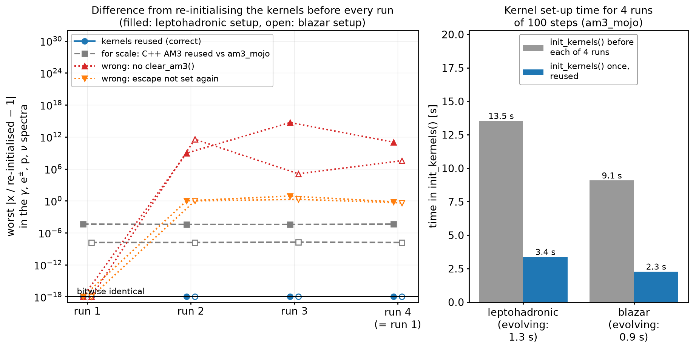
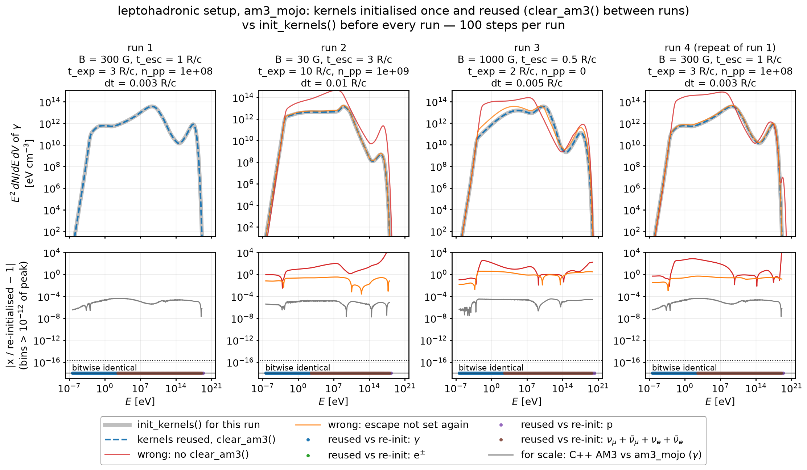
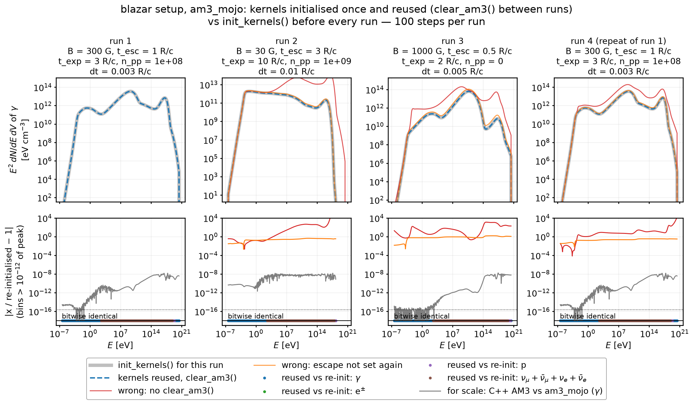
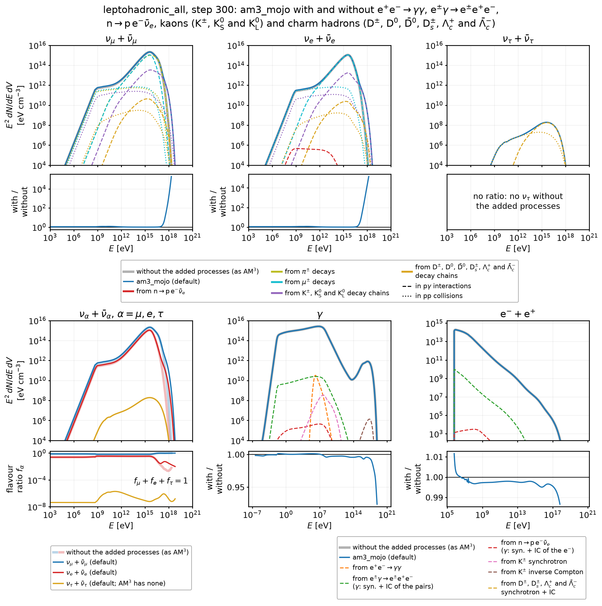
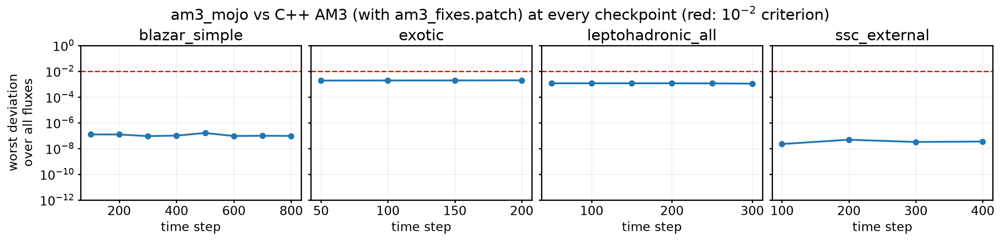
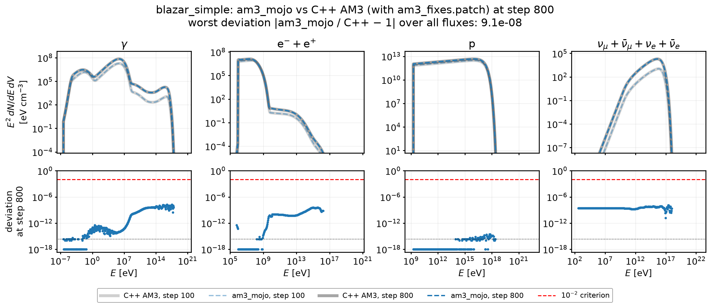
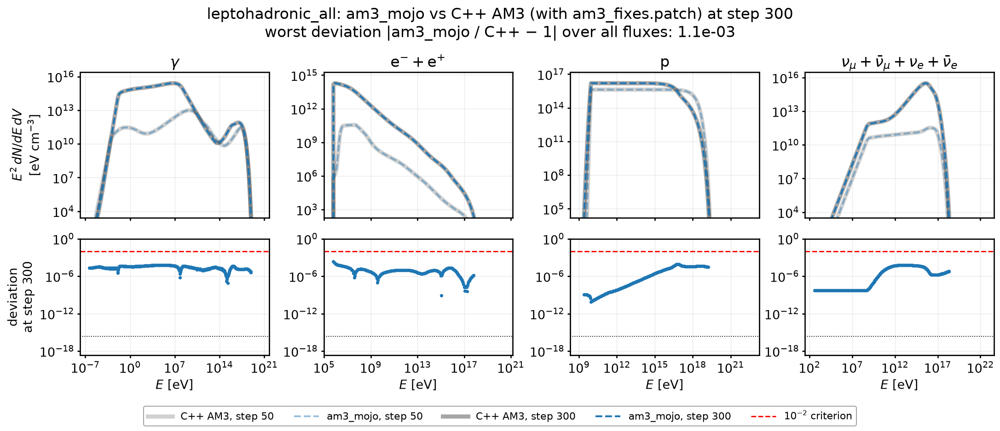
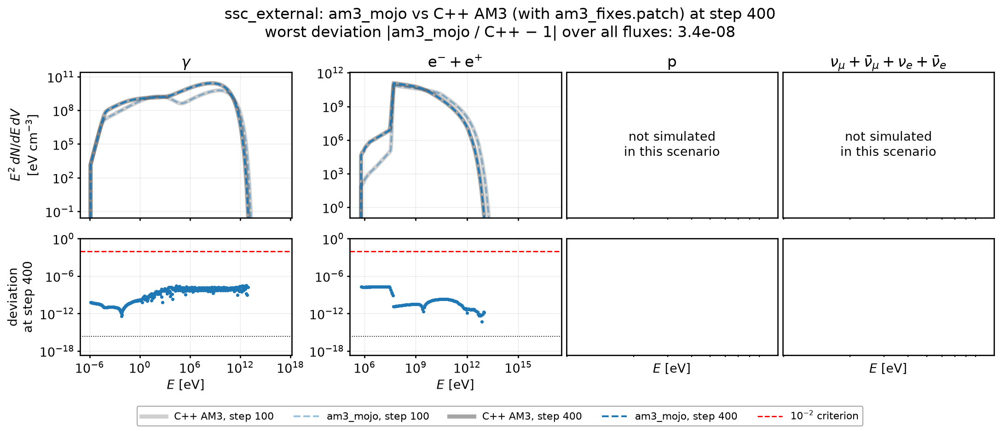
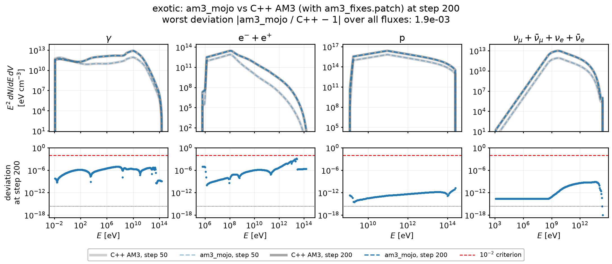

# am3_mojo

**am3_mojo** is the [AM³](https://gitlab.desy.de/am3/am3) lepto-hadronic interactions code written in [Mojo](https://www.modular.com/mojo), with the Python interface of AM³ v1.2.0. For the same physics, it runs **9.5–13.5x faster** per step on 4 threads than the serial C++ AM³. It also uses **up to 14.1x less memory** and sets up its kernels up to **3.9x faster**. With the same fixes and constants in the C++ code (see [Differences](#differences-from-the-c-original)), the simulated fluxes of the two codes agree to $10^{-7}\text{–} 10^{-5}$ or better in most energy bins. In every bin they agree to better than 1%.

am3_mojo also adds five processes that AM³ lacks: **electron–positron annihilation** ($\mathrm e^+\mathrm e^- \to \gamma\gamma$), **triplet pair production** ($\mathrm e^\pm\gamma$ $\to \mathrm e^\pm\mathrm e^+\mathrm e^-$), **neutron decay** ($\mathrm n \to \mathrm p\thinspace\mathrm e^-\bar\nu_e$), **kaons** (the production and decay of $\mathrm K^\pm$, $\mathrm K^0_\mathrm S$ and $\mathrm K^0_\mathrm L$), and **charm hadrons** (the production and decay of $\mathrm D^\pm$, $\mathrm D^0$, $\bar{\mathrm D}^0$, $\mathrm D_s^\pm$, $\Lambda_c^+$ and $\bar\Lambda_c^-$). All five are on by default and make a step take 34–137% longer. With them switched off, am3_mojo has AM³'s physics, and every comparison with the C++ AM³ runs this way (see [Processes am3_mojo adds to AM³](#added-processes)).

```python
import am3_mojo
a = am3_mojo.AM3()
a.set_process_pp(True)          # switch processes on/off
a.init_kernels()                # build the interaction kernels (once)
a.set_mag_field(10.0)           # source parameters
a.set_escape_timescale(3.3e4)
a.set_powerlaw_injection_parameters_protons(4.2e45, 1e46, 1.9e9, 1.9e9, 9.4e16, 2.0, 2.0, 1.0)
for _ in range(800):
    a.evolve_step()
E, photons = a.get_egrid_photons(), a.get_photons()   # E [eV], E dN/dE dV [cm^-3]
```

## Repository layout

```
src/
  am3_mojo_module.mojo     the Python extension module am3_mojo (class AM3), generated
                           by tools/gen_bindings.py
  am3_mojo/                the Mojo package
    utils/                 numerics: constants, libm wrappers, buffers, SIMD linear
                           algebra (Toeplitz/Hankel products), interpolation, tridiagonal
                           solver, Bessel functions, worker-pool parallelism
    model/                 run parameters, energy grids, particle densities
    solver/                the implicit PDE solver (Chang-Cooper + semi-analytic regimes)
    physics/               one module per process (synchrotron, inverse_compton,
                           pair_production, pair_annihilation, triplet (+ its QED
                           tables, triplet_tables), bethe_heitler, photohadron (+ kaon
                           and charm production, photopion_tables), proton_proton,
                           decays (pions, muons, neutrons, kaons, charm hadrons; also
                           the hadrons' inverse Compton; + lambda_c_semileptonic),
                           acceleration, escape, expansion, extra_cooling, injection)
    simulation/            the time step: coefficients and parallel species updates
    api/                   the Python-facing AM3 object
tests/
  unit/                    tests of am3_mojo on its own
  reference/               comparison with the C++ AM³ (+ setup_reference.sh that
                           downloads and builds it, and am3_fixes.patch, the fixes of
                           the AM³ bugs that am3_mojo fixes)
  harness/                 Mojo programs that print the code's kernels and tables, for
                           the unit tests and the checks
  literature_checks/       the added processes from the papers to the code: a folder
                           per process (annihilation/, triplet/, neutron_decay/, kaons/,
                           charm/) with a README that derives its equations and tables,
                           the derivation checks of each step, and the scripts that
                           compare the code with Monte Carlo and measured data or
                           measure its approximations; common/ holds the machinery of
                           the derivation checks; run_literature_checks.py runs the
                           checks and scripts (make literature_checks; not part of
                           make test)
  benchmark/               timings and per-stage profiles vs the C++ AM³
  plots/                   comparison, kernel-reuse and added-process figures
  support/                 what the tests, checks and figures share: the scenarios,
                           the runs of each implementation in its own process
                           (runs.py and the scripts it runs), the comparison
                           criterion (compare.py), the units and set-ups of the unit
                           tests (units.py, setups.py), the harness builds and
                           measured/ (the measured values behind the kaon and charm
                           production)
results/                   tables and figures of the last full run (make all), and
                           the outputs of make literature_checks (literature_checks/)
                           and of the tools (tools/), which git ignores
tools/                     what generates code and data: the binding generator, the
                           AM³ v1.2.0 interface specification (am3_api.json), the
                           methods am3_mojo adds (am3_mojo_api.json), the build backend
                           used by `pip install` (mojo_build_backend.py), triplet/, the
                           QED Monte Carlo that computes the triplet pair production
                           tables, and the extractors of measured data:
                           ky_angular_extract.py (the two-body kaon channels),
                           charm_pp_extract.py and charm_photoproduction_extract.py
                           (the digitised curves behind the charm production); their
                           outputs go to results/tools/
Makefile                   build / install / test / reference / benchmark / plots /
                           literature_checks / all
CITATION.cff               how to cite am3_mojo (and AM³)
pyproject.toml, uv.lock    the Python environment (Mojo 1.2.0, numpy, and the packages
                           of the tests, the checks and the generators in tools/)
```

## Installation

There are two ways to install am3_mojo. Most users only need the first.

| | Install am3_mojo only | Development set-up |
|---|---|---|
| What you get | `import am3_mojo` in your Python environment | the module, plus the tests, the C++ reference, benchmarks, plots and the checks against the literature |
| Python | 3.14 with pip (or uv) | uv, which installs Python 3.14 |
| `make`, `git`, `curl` | not needed | needed |
| Mojo | needed, but installed automatically by pip (see below) | installed by `uv sync` |
| C/C++ compiler | a C compiler (Mojo uses it to link) | needed (linking, and building the C++ reference) |

**Operating system:** macOS on Apple Silicon (tested on an Apple M5, macOS 26), or Linux on x86-64 or ARM64. Mojo supports Linux, but am3_mojo has not been tested on it yet.

### Install am3_mojo only

`pip` compiles am3_mojo with the Mojo compiler for your machine's CPU, which takes about 10 s. The only other requirement is a C compiler, which Mojo uses as its linker. On macOS, this is the Xcode Command Line Tools (`xcode-select --install`); on Linux, gcc or clang.

```bash
# an unpacked copy of the repository
pip install ./am3_mojo
```

What pip does with Mojo:

1. **While installing**, pip creates a temporary build environment and installs `mojo-compiler==1.2.0` into it (as declared under `[build-system]` in `pyproject.toml`). It compiles am3_mojo with this compiler and then deletes the build environment.
2. **In your environment**, pip installs am3_mojo with its two dependencies, `numpy` and `mojo-compiler==1.2.0`. The module loads the Mojo runtime libraries from `mojo-compiler` (`site-packages/modular/lib`), so do not uninstall that package: without it, `import am3_mojo` fails. The package also adds a `mojo` command to the environment, which am3_mojo itself does not use.

`uv pip install` works the same way.

Check the installation:

```bash
python -c "import am3_mojo; print(am3_mojo.__version__, am3_mojo.AM3())"
```

### Development set-up

This set-up needs uv, `make`, `git`, `curl` and a C/C++ compiler. For the reference tests, `git` and `curl` download the original C++ AM³ and its dependencies, and the C++ compiler builds them.

```bash
git clone https://github.com/chenlinear/am3_mojo && cd am3_mojo
uv sync            # .venv with Python 3.14, Mojo 1.2.0, numpy, and the packages of the tests
                   # and of the checks (see below)
make build         # compile the module -> build/am3_mojo.so  (about 10 s)
make install       # make `import am3_mojo` work anywhere in .venv (the tests and checks
                   # find build/ without it)
```

Check the installation (after `make install`):

```bash
.venv/bin/python -c "import am3_mojo; print(am3_mojo.__version__, am3_mojo.AM3())"
```

To run all the tests and the checks against the literature, see [Tests, reference comparison and benchmarks](#tests-reference-comparison-and-benchmarks).

## Using am3_mojo

The `AM3` class provides the complete AM³ v1.2.0 Python interface: 383 methods with the same names, arguments and docstrings. Where am3_mojo behaves differently, 65 of these docstrings are adapted (e.g. `True`/`False` for the switches). Another 138 methods control the [processes am3_mojo adds](#added-processes). The [AM³ documentation](https://am3.readthedocs.io/en/latest/) and its example notebooks therefore apply, with `import am3` replaced by `import am3_mojo`. `help` shows each method's documentation, e.g. `help(am3_mojo.AM3.set_process_pp)`.

- **Threads.** The parallel sections run on the calling thread and on the Mojo runtime's worker pool. By default, the number of threads is the pool's number of workers, which equals the number of performance cores (4 on an M5). `AM3_MOJO_THREADS=N` sets another number, and `AM3_MOJO_THREADS=1` runs serially. The results are bitwise identical for any $N$. The workers sleep as soon as a section ends: on import, am3_mojo sets the runtime's `MODULAR_THREAD_BUSY_WAIT_US` to 0 unless it is already set. Workers that spin between the sections slow down the serial work there, and a step on 4 threads takes 13–15% longer.
- **Switches** are Python booleans: `set_process_pp(True)`, `get_process_escape() -> True`. The setters accept only `True` and `False`, and any other value, including `0`, `1` and numpy booleans, raises an exception. As in AM³, set the switches before `init_kernels()`, which builds only the kernels of the processes that are on.
- **Reusing kernels.** `init_kernels()` is the expensive part of a run. To run several simulations with one set of kernels:
  ```python
  a = am3_mojo.AM3(); <switches>; a.init_kernels()      # once
  for p in parameter_sets:
      a.clear_am3()                    # particles, injection, escape and extra-cooling arrays -> 0
      a.set_mag_field(p.B)             # rebuilds only the B-dependent synchrotron kernels
      a.set_escape_timescale(p.t_esc)  # escape rates must be set again after clear_am3()
      a.set_powerlaw_injection_parameters_electrons(...)   # injection too
      for _ in range(n): a.evolve_step()
  ```

  A reused object gives results bitwise identical to those of a fresh one. `tests/unit/test_reuse.py` checks this, and `results/plots/reuse_summary.png` shows it. In its left panel, correctly reused kernels (blue) match kernels rebuilt before every run bit for bit. Skipping `clear_am3()`, or not setting the escape timescale again, gives wrong spectra from the second run on. The grey squares show how far the C++ AM³ is from am3_mojo. The right panel shows the kernel set-up time of four runs falling by a factor of 4.

  

  The figures below show the individual runs of the leptohadronic and the blazar set-ups. Each shows the photon spectra (top) and, per energy bin, how the photon, $\mathrm{e}^\pm$, proton and neutrino spectra differ from those with re-initialised kernels (bottom). Every getter returns bitwise the same values as in the run with re-initialised kernels.

  

  

  `clear_am3()` sets the particle densities, the injection, escape and extra-cooling rates and all coefficient arrays to zero. As in AM³, it keeps the kernels, the switches and the scalar parameters. These are the magnetic field $B$, the timescales, the target density of $\mathrm{pp}$ collisions, the time step and the power-law parameters. $B$, the expansion timescale, the $\mathrm{pp}$ density and the time step therefore carry over to the next run without being set again. The escape and injection rates, however, stay zero until `set_escape_timescale()` and `set_powerlaw_injection_parameters_*()` (or `set_injection_rate_*()`) are called again. Meanwhile, `get_escape_timescale()` and `get_powerlaw_injection_parameters_*()` still report the old values. (With `set_estimate_max_energies(True)`, the power-law injection is recomputed from the stored parameters from the second step on.)

<a id="added-processes"></a>

## Processes am3_mojo adds to AM³

Table 1 of the hadronic code comparison of [Cerruti et al. (2026, ApJS 282, 22)](https://arxiv.org/abs/2411.14218) lists the physical processes of five codes. am3_mojo adds four processes that other codes have and AM³ lacks:

| Process (Table 1) | AM³ | ATHEνA | [Böttcher et al. 2013](https://arxiv.org/abs/1304.0605) | LeHa-Paris | LeHaMoC | am3_mojo |
|---|---|---|---|---|---|---|
| electron–positron annihilation | ✗ | ✓ | ✓ | ✗ | ✗ | ✓ ([Svensson 1982](https://ui.adsabs.harvard.edu/abs/1982ApJ...258..321S): exact; peak approximation where both $\gamma \gt 100$) |
| triplet pair production | ✗ | ✓ | ✗ | ✗ | ✗ | ✓ (exact lowest-order QED, all three products) |
| neutron decay | ✗ | ✓ | ✗ | ✗ | ✗ | ✓ (allowed $\beta$ spectrum, exact boost; protons, electrons and antineutrinos) |
| kaon synchrotron radiation | ✗ | ✓ | ✗ | ✗ | ✗ | ✓ ($\mathrm K^\pm$, $\mathrm K^0_\mathrm S$ and $\mathrm K^0_\mathrm L$ from $\mathrm p\gamma$, $\mathrm n\gamma$ and $\mathrm{pp}$, evolved as species) |

am3_mojo also adds [charm hadrons](tests/literature_checks/charm/README.md), which Table 1 does not list. All five processes are **on by default**. Every comparison with the C++ AM³ switches them off (the test implementation `mojo-am3` in `tests/support/paths.py`). None of their terms then acts, so am3_mojo solves AM³'s equations.

| Process | Switches (default `True`) | Outputs and timescales |
|---|---|---|
| $\mathrm e^+\mathrm e^- \to \gamma\gamma$ | `set_process_pair_annihilation` (master switch); `_emission` / `_cooling`: the photons / the $\mathrm e^\pm$ loss | `get_photons_pair_annihilation()`; `get_t_electron_annihilation()`, `get_t_positron_annihilation()` |
| $\mathrm e^\pm\gamma$ $\to \mathrm e^\pm\mathrm e^+\mathrm e^-$ | `set_process_triplet_pair_production` (master switch; also the photon absorption); `_emission` / `_cooling`: the produced pairs / the $\mathrm e^\pm$ energy loss | `get_pairs_triplet()` (the $\mathrm e^\pm$ component) with its photons `get_photons_triplet_pairs_syn()`, `get_photons_triplet_pairs_compton()` and `get_photons_triplet_pairs_syn_compton()`; `get_t_pair_triplet()` ($\mathrm e^\pm$ energy loss), `get_t_photon_triplet()` (photon absorption) |
| $\mathrm n \to \mathrm p\thinspace\mathrm e^-\bar\nu_e$ | `set_process_neutron_decay`: the decay of the neutrons and its protons, electrons and electron antineutrinos | `get_electrons_neutron_decay()` (the $\mathrm e^\pm$ component) with its photons `get_photons_neutron_decay_electrons_syn()`, `get_photons_neutron_decay_electrons_compton()` and `get_photons_neutron_decay_electrons_syn_compton()`; `get_electron_anti_neutrinos_neutron_decay()` (the neutrino component); `get_t_neutron_decay()` |
| kaons | `set_process_kaons` (master switch): $\mathrm K^\pm$, $\mathrm K^0_\mathrm S$ and $\mathrm K^0_\mathrm L$ production in photo-hadronic interactions and $\mathrm{pp}$ collisions, their evolution and decay | `get_kaon_plus()`, `get_kaon_minus()`, `get_kaons()` ($\mathrm K^+ + \mathrm K^-$), `get_kaon_0S()`, `get_kaon_0L()`; `get_t_kaon_escape()` (charged), `get_t_kaon_neutral_escape()`; a user-set extra cooling, as for AM³'s other species: `set_t_kaon_extra_cooling()` / `get_t_kaon_extra_cooling()` |
| kaon decays | `set_process_kaon_decay`: every non-radiative mode above 0.1% and the smaller $\mathrm K^0_\mathrm S$ semileptonic and $\mathrm K^0_\mathrm L \to \pi^0\pi^0$ modes (see [the kaon page](tests/literature_checks/kaons/README.md#decays)) | `get_t_kaon_decay()` (charged), `get_t_kaon_0S_decay()`, `get_t_kaon_0L_decay()`; AM³'s photo-hadronic and $\mathrm{pp}$ neutrino components by parent: the neutrinos of the decays of the pions made in the interactions, `get_neutrinos_pion_decay_photopion()` and `get_neutrinos_pion_decay_proton_proton()` ($\nu_\mu$ and $\bar\nu_\mu$ only); those of the decays of these pions' muons, `get_neutrinos_muon_decay_photopion()` and `get_neutrinos_muon_decay_proton_proton()`; and those of the kaon decays and of the pions and muons the kaons decay into, `get_neutrinos_kaon_decay_photopion()` and `get_neutrinos_kaon_decay_proton_proton()` (each also per flavour, e.g. `get_muon_neutrinos_pion_decay_photopion()`) |
| kaon synchrotron | `set_process_kaon_syn` (master switch); `_emission` / `_cooling`: the photons / the kaon energy loss | `get_photons_kaons_syn()`; `get_t_kaon_syn()` |
| kaon inverse Compton | `set_process_kaon_compton` (master switch); `_emission` / `_cooling`: the photons / the kaon energy loss | `get_photons_kaons_compton()`; `get_t_kaon_compton()` |
| charm hadrons | `set_process_charm` (master switch): $\mathrm D^\pm$, $\mathrm D^0$, $\bar{\mathrm D}^0$, $\mathrm D_s^\pm$, $\Lambda_c^+$ and $\bar\Lambda_c^-$ production in photo-hadronic interactions and $\mathrm{pp}$ collisions, their evolution and decay | `get_charm_hadrons()` (all eight), `get_D_plus()`, `get_D_minus()`, `get_D_zero()`, `get_anti_D_zero()`, `get_Ds_plus()`, `get_Ds_minus()`, `get_Lambda_c_plus()`, `get_anti_Lambda_c_minus()`; `get_t_charm_escape()` (charged), `get_t_charm_neutral_escape()`; `set_t_charm_extra_cooling()` / `get_t_charm_extra_cooling()` |
| charm decays | `set_process_charm_decay`: the PDG modes above 0.5% (semileptonic above 0.1%; see [the charm page](tests/literature_checks/charm/README.md#decays)) | `get_t_D_plus_decay()`, `get_t_D_zero_decay()`, `get_t_Ds_decay()`, `get_t_Lambda_c_decay()`; AM³'s photo-hadronic and $\mathrm{pp}$ neutrino components by parent: the neutrinos of the charm decays and of the kaons, pions and muons they decay into, `get_neutrinos_charm_decay_photopion()` and `get_neutrinos_charm_decay_proton_proton()` (each also per flavour); their $\nu_\tau$, `get_tau_neutrinos_charm_decay_photopion()`, `get_tau_anti_neutrinos_charm_decay_photopion()` and the same for `proton_proton` |
| charm synchrotron | `set_process_charm_syn` (master switch); `_emission` / `_cooling`: the photons / the energy loss of the charged charm hadrons | `get_photons_charm_syn()`; `get_t_charm_syn()` |
| charm inverse Compton | `set_process_charm_compton` (master switch); `_emission` / `_cooling`: the photons / the energy loss | `get_photons_charm_compton()`; `get_t_charm_compton()` |

Each switch has a getter (`get_process_…`). AM³'s own `set_process_annihilation`, `get_pairs_annihilation()` and `get_t_photon_annihilation()` belong to $\gamma\gamma$ pair production, not to electron–positron annihilation. The printed switch table and the profiler (`get_profiled_time_labels()`) list the added processes too. Their methods are specified in `tools/am3_mojo_api.json`.

### Derivations and checks

Each added process has a folder in [tests/literature_checks/](tests/literature_checks/README.md) whose README derives it: [electron–positron annihilation](tests/literature_checks/annihilation/README.md), [triplet pair production](tests/literature_checks/triplet/README.md), [neutron decay](tests/literature_checks/neutron_decay/README.md), [kaons](tests/literature_checks/kaons/README.md) and [charm hadrons](tests/literature_checks/charm/README.md). The README starts with the equations and tables of the cited papers. From them it derives the equations and tables that the Mojo code uses, and it names the struct or function that uses each. The folder's Python checks verify that each derivation is correct, exactly with sympy or to 50 digits with mpmath. Where a table comes from measured data or a Monte Carlo, a script of the folder recomputes or checks it.

### Effect on a simulation

`results/plots/added_processes_leptohadronic_all.png` (`make plots`) compares am3_mojo with and without the added processes in the `leptohadronic_all` scenario. It shows the spectra of the three neutrino flavours, of the photons and of the $\mathrm{e}^\pm$, and the neutrino flavour ratio. Its dashed and dotted curves are components of the default run: those of the added processes and, for the neutrinos, those of each parent. The parents are the pions, their muons, the kaons and the charm hadrons, from photo-hadronic interactions and from $\mathrm{pp}$ collisions. The flavour ratio, normalised to a sum of 1, is that of the neutrinos leaving the source, before oscillations.



**Neutrinos.** Kaon decays extend the $\nu_\mu$ and $\nu_e$ spectra beyond AM³'s cutoff. At the highest energies, pions and muons lose their energy to synchrotron radiation before they decay. The charged kaons, heavier and shorter-lived, decay before they lose their energy, and the neutral kaons do not radiate at all. Above $10^{18}$ eV, kaon decays therefore make nearly all the neutrinos, and the spectra are up to $2 \times 10^5$ times higher. The total neutrino energy rises by only 1.1%, because the kaons take their energy from the pions of multi-pion production. This is the known kaon effect on high-energy neutrino spectra ([Baerwald, Hümmer & Winter 2011](https://arxiv.org/abs/1009.4010); for the $\nu_e$ from $\mathrm{K}^0$ decays, [Petropoulou et al. 2014](https://arxiv.org/abs/1405.2091)). Charm decays make only $3 \times 10^{-5}$ of the neutrino energy here, and at most $7 \times 10^{-4}$ in any bin. Their $\nu_\tau$ carry $10^{-7}$ of it. In the flavour ratio, the $\nu_e$ share falls above $10^{16}$ eV, because the muons radiate their energy before they decay. Above $10^{17}$ eV, the $\nu_e$ from kaon decays keep it higher.

**Other fluxes.** The added processes change the other fluxes only slightly. Below $10^{17}$ eV, the photon and $\mathrm{e}^\pm$ spectra change by at most 1.2% in any bin. Near their cutoffs they are up to 7.6% (photons) and 1.3% ($\mathrm{e}^\pm$) lower, as the kaons and charm hadrons take energy from the pions of multi-pion production. Triplet pair production and neutron decay change every total spectrum by less than $10^{-4}$.

## Tests, reference comparison and benchmarks

Everything runs through `make`. To run all the tests and all the checks:

```bash
make reference          # once: download and build the C++ AM³ for the reference tests
make test               # all tests
make literature_checks  # the literature checks, outputs in results/literature_checks/
```

All the targets:

| Command | What it does | Needs | Time (on Apple M5) |
|---|---|---|---|
| `make test-unit` | tests of am3_mojo on its own (185) | `make build` | 4 min |
| `make reference` | downloads and builds the C++ AM³, original and patched (see below) | internet, C++ compiler | 1–2 min (once) |
| `make test-reference` | compares am3_mojo with the C++ AM³ (26) | `make reference` | 2 min |
| `make test` | all tests (211); reference tests are skipped if the reference is not built | | 6 min |
| `make test-asserts` | the unit tests on a build with Mojo's bounds checks and assertions (`build-asserts/`) | | 4.5 min (+ the compile) |
| `make benchmark` | timings, memory and per-stage profiles vs the C++ AM³ | `make reference` | 5.5 min |
| `make plots` | comparison, kernel-reuse and added-process figures | | 0.5 min |
| `make literature_checks` | the derivation checks, the inventory and every script of `tests/literature_checks/` (`tests/literature_checks/run_literature_checks.py`), with the arguments of the figures their READMEs quote, and `tools/ky_angular_extract.py`; outputs in `results/literature_checks/`, the tool's in `results/tools/` | | 5 min |
| `make all` | build + reference + test + benchmark + plots + literature_checks | | 17 min (+ reference build) |

Results are written to `results/`, whose tables and figures are part of the repository. The results of the last full run (`make all` on an Apple M5) can therefore be seen without running anything:
- `reference/summary.md`: the deviation table;
- `benchmark/benchmark.md` and `benchmark/benchmark.json`: step and set-up times, and memory;
- `benchmark/stages_<scenario>.md`: per-stage profiles;
- `plots/*.png`: the figures shown in this README.

The raw simulation outputs of the tests are not part of the repository. The tests write them to `results/runs/` and `results/reuse/`: about 45 MB of `.npz` files, rewritten by every test run. `make plots` adds 9 MB of reuse variants. `make test-asserts` writes its own to `results/runs-build-asserts/` and `results/reuse-build-asserts/`. `make plots` draws the figures from these outputs. It first reruns any output that is missing or older than the module, so the figures always show the current build.

The outputs of `make literature_checks` and of the tools are not part of the repository either. `results/literature_checks/` holds each script's output and `summary.txt`. `results/tools/` holds the outputs of the tools, such as `ky_angular_extract.txt` and the triplet Monte Carlo tables of [tools/triplet/](tools/triplet/README.md).

pytest can also be run directly, for example `.venv/bin/python -m pytest tests/unit/test_api.py -v` or `-m "not reference"`. Each test file's docstring says what it checks.

<a id="reference-comparison"></a>
### Comparison with the original C++ AM³ (`tests/reference`)

`make reference` (`tests/reference/setup_reference.sh`) does the following:
1. clones AM³ from `gitlab.desy.de/am3/am3` at commit `04d63d9`: the tag v1.2.0 plus 7 commits that change only its documentation and examples (its package metadata and `am3.__version__` still say 1.0.1);
2. downloads and builds GSL 2.8, Eigen 3.4.0 and, on macOS, LLVM libomp 19.1.7 into `tests/reference/work/deps`;
3. compiles two serial builds of AM³'s Python module:
   - the original;
   - the original with the fixes of the AM³ bugs that am3_mojo fixes and with am3_mojo's constants (`am3_fixes.patch`: 70 hunks in 15 source files, each marked with a comment; see [tests/reference/README.md](tests/reference/README.md)). It is rebuilt whenever the patch changes.

It can be re-run safely, since completed steps are skipped. `AM3_REFERENCE_DIR` changes the work directory, and `AM3_SOURCE_DIR` uses an existing AM³ checkout instead of cloning.

The reference tests run am3_mojo with the [processes it adds](#added-processes) switched off (`mojo-am3`), so that both codes have the same physics. The simulations are the four scenarios of [tests/support/scenarios.py](tests/support/scenarios.py), which drive the public API only. They are compared with the patched build, so that both codes solve the same equations. The benchmark uses the patched build too, so that both codes do the same work. So does `test_api_defaults.py`, as the original has AM³'s own constants. Only getters that both codes have are compared.

**Criterion** (`tests/support/compare.py`):
- **Fluxes:** particle densities, component spectra and injection rates must agree to $10^{-2}$ relative. The check covers every energy bin above $10^{-12}$ of the array's peak in particle number ($E\thinspace dN/dE$) or in energy ($E^2\thinspace dN/dE$, the quantity flux plots show). On a flux plot, which spans many orders of magnitude, a 1% difference is below the line width. The bins below both floors are not visible on it.
- **Grids:** these must be identical.
- **Timescales:** these are reported, not checked, on the bins where the rate $1/{t}$ is above $10^{-12}$ of its largest. The longest timescales, including those that stand for an absent process, carry no information.
- Every array must exist in both codes with the same shape (except the two neutrino timescales described in [tests/reference/README.md](tests/reference/README.md), compared on AM³'s bins). A flux that is not finite in a bin the criterion checks counts as a failure.

Current results:

| Scenario | Flux arrays | Worst flux deviation | Worst timescale deviation |
|---|---|---|---|
| blazar_simple | 768 | 1.5e-07 | 2.1e-07 |
| exotic | 384 | 1.9e-03 | 8.4e-04 |
| leptohadronic_all | 576 | 1.1e-03 | 2.3e-04 |
| ssc_external | 384 | 4.6e-08 | 1.4e-07 |

`make plots` shows the comparison as figures. `deviation_vs_time.png` plots the worst deviation over all fluxes at every checkpoint of the four scenarios. The dashed red line is the $10^{-2}$ criterion:



`spectra_<scenario>.png` overlays the spectra of both codes at the first and the last checkpoint (top). It also shows the deviation of every energy bin the criterion checks at the last checkpoint (bottom). These bins cover the whole plotted range. The C++ spectra are drawn as thick grey lines, and the am3_mojo spectra as dashed blue lines on top of them. The AM³ example model:



Every process on:



A leptonic synchrotron self-Compton model with an external photon field:



Exotic:



## Performance: am3_mojo (4 threads) vs the C++ original (serial)

`make benchmark` runs every scenario three times, in one fresh process per code and scenario. It reports the fastest run and the peak memory of one simulation. Every ratio below is computed from the unrounded values. The benchmarks ran on an Apple M5 (4 performance and 6 efficiency cores, 16 GB). The C++ AM³ is the serial (single-threaded) Release build made by `make reference` (clang, `-O3`). It includes the fixes of `am3_fixes.patch`, so both codes solve the same equations.

**Time per evolution step** (lower is better). Both codes compute the same physics here: am3_mojo runs with the [processes it adds](#added-processes) switched off.

| Scenario | C++ AM³ (1 thread) | am3_mojo (1 thread) | am3_mojo (4 threads) | Speed-up over C++ (1 thread / 4 threads) |
|---|---|---|---|---|
| `blazar_simple` | 11.54 ms | 1.89 ms | **0.85 ms** | 6.1x / **13.5x** |
| `leptohadronic_all` | 17.01 ms | 2.90 ms | **1.30 ms** | 5.9x / **13.1x** |
| `ssc_external` | 3.03 ms | 0.58 ms | **0.23 ms** | 5.2x / **13.1x** |
| `exotic` | 11.67 ms | 1.87 ms | **1.23 ms** | 6.2x / **9.5x** |

**Cost of the added processes** (am3_mojo on 4 threads, time per evolution step):

| Scenario | Without them | With them (default) | Extra time |
|---|---|---|---|
| `blazar_simple` | 0.85 ms | 2.02 ms | +137% |
| `leptohadronic_all` | 1.30 ms | 3.05 ms | +136% |
| `ssc_external` | 0.23 ms | 0.31 ms | +34% (triplet pair production only: merged $\mathrm{e}^\pm$, so no annihilation; no hadrons, so no neutron decay, kaons or charm) |
| `exotic` | 1.23 ms | 1.96 ms | +60% |

**Kernel set-up and peak memory** (am3_mojo on 4 threads; the peak memory varies by up to about 10 MB from run to run):

| Scenario | Kernel set-up (`init_kernels`), C++ → am3_mojo | Peak memory, C++ → am3_mojo | Added processes: set-up, memory |
|---|---|---|---|
| `blazar_simple` | 6.91 s → **1.79 s** (3.9x) | 2.92 GB → **0.30 GB** (9.8x) | +0.38 s, +45 MB |
| `leptohadronic_all` | 11.05 s → **2.85 s** (3.9x) | 2.92 GB → **0.30 GB** (9.7x) | +0.51 s, +51 MB |
| `ssc_external` | 0.14 s → **0.09 s** (1.7x) | 2.11 GB → **0.15 GB** (14.1x) | +0.01 s, +0 MB |
| `exotic` | 1.48 s → **0.41 s** (3.6x) | 1.04 GB → **0.25 GB** (4.2x) | +0.25 s, +12 MB |

Where the extra time of the added processes goes, from the profiler:
- $\boldsymbol{\mathbf{e}^+\mathbf{e}^-}$ **annihilation:** its photon source reads its large photon kernel once per step, and the $\mathrm{e}^\pm$ components are evolved as separate $\mathrm{e}^-$ and $\mathrm{e}^+$ halves, which doubles their solves.
- **Triplet pair production:** the convolution of its kernel rows with the photons, which is compute-bound.
- **Neutron decay:** two small kernel products per step, a negligible cost.
- **Kaons:** the production, evolution, radiation and decays of four more species. With kaons from both photo-hadronic interactions and $\mathrm{pp}$ collisions, a second set of kaon populations is evolved.
- **Charm hadrons:** the production, evolution and decays of eight species per origin. The decays, whose kernels feed 22 products, take the largest share, followed by the evolution of the species and of the kaons from their decays. Their synchrotron and inverse-Compton cooling is computed for three masses.
- **Neutrinos by parent:** the pions, muons and neutrinos of the kaon and charm decays are evolved separately from those of the pions made in the interactions. This adds components. The $\nu_\mu$ and $\bar\nu_\mu$ of these pions' decays are also evolved separately from the neutrinos of their muons.

The costs do not simply add up: with annihilation on, the triplet pairs are also evolved as $\mathrm{e}^-$ and $\mathrm{e}^+$ halves. The set-up and memory of the added processes are small next to AM³'s own kernels. Charm and the annihilation photon kernel take most of both.

`exotic` uses the full $\gamma\gamma$ pair-production kernel. AM³ stores `nbins_pho³` entries. am3_mojo stores only the part of each row that its sums read: 31% of `nbins_lep × nbins_pho²` entries, 73 MB. This kernel takes the largest part of the step and of the memory in both codes. In `ssc_external` (a small leptonic model on a reduced grid), kernel set-up takes a fraction of a second in both codes.

Per-stage time of one step (`results/benchmark/stages_*.md`), from the profiler built into both codes (`set_profile_timing`). The profiler averages 300 steps after 20 warm-up steps, in one run, and its total is the sum of the stages. The time per step above averages whole runs, including the slow first step, and is the fastest of three runs. The two totals therefore differ by up to 5%, and so do their speed-ups (13.8x here against 13.5x above for `blazar_simple`):

`blazar_simple` (the AM³ example model):

| Stage | C++ AM3 (serial) | am3_mojo, 4 threads | Speed-up |
|---|---|---|---|
| calc. coeff. photon | 6.297 ms | 0.325 ms | 19.4x |
| &nbsp;&nbsp;&nbsp;↳ pair compton em. | 5.035 ms | 0.270 ms | 18.7x |
| &nbsp;&nbsp;&nbsp;↳ pair syn. em. | 0.856 ms | 0.043 ms | 20.1x |
| &nbsp;&nbsp;&nbsp;↳ pair syn. abs. | 0.126 ms | 0.030 ms | 4.2x |
| &nbsp;&nbsp;&nbsp;↳ proton compton em. | 0.095 ms | 0.016 ms | 6.1x |
| &nbsp;&nbsp;&nbsp;↳ pi0 decay | 0.055 ms | 0.017 ms | 3.3x |
| &nbsp;&nbsp;&nbsp;↳ pair compton abs. | 0.046 ms | 0.025 ms | 1.8x |
| &nbsp;&nbsp;&nbsp;↳ photo-pion loss | 0.042 ms | 0.007 ms | 5.6x |
| &nbsp;&nbsp;&nbsp;↳ proton syn. em. | 0.041 ms | 0.011 ms | 3.7x |
| calc. coeff. pairs | 2.854 ms | 0.093 ms | 30.8x |
| evolve pairs | 1.057 ms | 0.065 ms | 16.3x |
| calc. coeff. proton/neutron | 0.554 ms | 0.087 ms | 6.3x |
| calc. coeff. neutrino | 0.326 ms | 0.053 ms | 6.1x |
| evolve proton | 0.161 ms | 0.024 ms | 6.6x |
| calc. coeff. muon | 0.090 ms | 0.016 ms | 5.5x |
| evolve photon | 0.058 ms | 0.050 ms | 1.2x |
| calc. coeff. pion | 0.051 ms | 0.012 ms | 4.4x |
| photons -> had. grid | 0.040 ms | 0.001 ms | 71.1x |
| evolve neutrino | 0.022 ms | 0.028 ms | 0.8x |
| (stages below 0.02 ms in both codes omitted) | | | |
| **total of a step** | **11.56 ms** | **0.83 ms** | **13.8x** |

`leptohadronic_all` (every process on):

| Stage | C++ AM3 (serial) | am3_mojo, 4 threads | Speed-up |
|---|---|---|---|
| calc. coeff. photon | 6.736 ms | 0.429 ms | 15.7x |
| &nbsp;&nbsp;&nbsp;↳ pair compton em. | 5.043 ms | 0.308 ms | 16.4x |
| &nbsp;&nbsp;&nbsp;↳ pair syn. em. | 0.855 ms | 0.088 ms | 9.7x |
| &nbsp;&nbsp;&nbsp;↳ pair syn. abs. | 0.125 ms | 0.026 ms | 4.9x |
| &nbsp;&nbsp;&nbsp;↳ pion compton em. | 0.124 ms | 0.015 ms | 8.4x |
| &nbsp;&nbsp;&nbsp;↳ muon compton em. | 0.120 ms | 0.014 ms | 8.4x |
| &nbsp;&nbsp;&nbsp;↳ proton compton em. | 0.096 ms | 0.017 ms | 5.7x |
| &nbsp;&nbsp;&nbsp;↳ pi0 decay | 0.091 ms | 0.060 ms | 1.5x |
| &nbsp;&nbsp;&nbsp;↳ pair annihil. | 0.081 ms | 0.062 ms | 1.3x |
| &nbsp;&nbsp;&nbsp;↳ pair compton abs. | 0.047 ms | 0.046 ms | 1.0x |
| &nbsp;&nbsp;&nbsp;↳ photo-pion loss | 0.041 ms | 0.008 ms | 5.4x |
| &nbsp;&nbsp;&nbsp;↳ proton syn. em. | 0.040 ms | 0.024 ms | 1.7x |
| &nbsp;&nbsp;&nbsp;↳ pion syn. em. | 0.037 ms | 0.032 ms | 1.2x |
| &nbsp;&nbsp;&nbsp;↳ muon syn. em. | 0.036 ms | 0.039 ms | 0.9x |
| calc. coeff. pairs | 2.915 ms | 0.144 ms | 20.2x |
| evolve muon | 2.139 ms | 0.085 ms | 25.3x |
| evolve pairs | 1.610 ms | 0.100 ms | 16.2x |
| evolve pion | 1.195 ms | 0.091 ms | 13.1x |
| calc. coeff. proton/neutron | 0.552 ms | 0.089 ms | 6.2x |
| calc. coeff. neutrino | 0.436 ms | 0.063 ms | 7.0x |
| calc. coeff. pion | 0.227 ms | 0.031 ms | 7.3x |
| evolve proton | 0.166 ms | 0.035 ms | 4.7x |
| calc. coeff. muon | 0.120 ms | 0.020 ms | 6.0x |
| evolve photon | 0.080 ms | 0.062 ms | 1.3x |
| photons -> had. grid | 0.040 ms | 0.000 ms | 87.5x |
| evolve neutrino | 0.033 ms | 0.034 ms | 0.9x |
| (stages below 0.02 ms in both codes omitted) | | | |
| **total of a step** | **16.27 ms** | **1.24 ms** | **13.2x** |

The indented rows (↳) are parts of "calc. coeff. photon" and are included in its time. On 4 threads, all but the inverse-Compton emission run as the tasks of one parallel section, so their times add up to more than the stage's. AM³'s profiler label "pair annihil." stands for the $\gamma\gamma$ absorption of the photons. The total is the sum of the stages. `tests/benchmark/profile_stages.py` describes how it relates to the benchmark's time per step.

### What makes am3_mojo faster

Most of the gain comes from better algorithms, not only from threads. [tests/benchmark/README.md](tests/benchmark/README.md) explains each improvement:
- **Inverse-Compton emission** from a 2.71 MB table instead of AM³'s 236.1 MB dense kernel, using the kernel's structure on logarithmic grids, as a matrix product in register blocks.
- **Decay and photo-pion kernels** as Toeplitz/Hankel products. On the logarithmic grids these matrices are constant along their diagonals (Toeplitz) or anti-diagonals (Hankel). A product with them is then a convolution of a few hundred values instead of a dense matrix product. The decays of all particle sets of a step run in one parallel pass.
- **Bethe–Heitler emission** from packed windows of its kernel, summed only over the proton bins that hold particles.
- **Cooling rates** computed once per species and step instead of once per component.
- **SIMD and parallel sections** on the calling thread and the Mojo worker pool, with bitwise identical results for any thread count.
- **Less memory**, from these forms and from allocating the full $\gamma\gamma$ pair kernel only when it is used, and then only the part of each row that is read.
- **Hadron inverse-Compton emission and the interpolation between grids** without AM³'s loops over every bin pair and its per-bin copies.

## Differences from the C++ original

am3_mojo keeps the physics and the interface of AM³ v1.2.0 and adds five processes. [tests/reference/README.md](tests/reference/README.md) describes each difference in detail.

**Added processes.** am3_mojo adds electron-positron annihilation, triplet pair production, neutron decay, kaons and charm hadrons (see [Processes am3_mojo adds to AM³](#added-processes)). These processes are on by default. With them switched off, am3_mojo has AM³'s physics (with the fixes and constants below).

**Bugs of AM³ v1.2.0 that am3_mojo fixes.** am3_mojo fixes bugs in AM³'s solver: the sign of its Green's function, its source integral, the boundaries of its windows, regime 4 and the top bins of a grid. It also fixes bugs in the simulation: the quantum-synchrotron cooling of heavy particles, the series of the inverse-Compton cooling functions, the muons of pion decays and their $\mathrm e^\pm$, and the maximum-energy estimates. Further simulation bugs concern the decay products and injections of some particles, the photons on the hadron grid after `update_energy_grid`, and stale decay sources. Other fixes remove reads and writes past the end of arrays and an OpenMP data race, and make calls that AM³ does not check raise an exception. Each fix has a regression test in `tests/unit/test_fixes.py`. The C++ build used in the comparisons has the same fixes (`tests/reference/am3_fixes.patch`), except those of the interface and of the OpenMP race. The solver fixes change AM³'s results in common set-ups, above all the $\mathrm e^\pm$ spectra. The fix of the muons of pion decays raises the neutrinos, the $\nu_e$ most. [tests/reference/README.md](tests/reference/README.md#effect-of-the-fixes-on-the-four-scenarios) says which fixes matter in the four scenarios of the tests.

**Constants.** am3_mojo takes its physical constants and its particle masses and mean lives from [PDG 2026](https://pdg.lbl.gov/2026/). They are in `src/am3_mojo/utils/constants.mojo`, which cites the PDG table or listing page of each. AM³ has rounded or older values. The C++ build of the comparisons has am3_mojo's values. [tests/reference/README.md](tests/reference/README.md#constants) lists them.

**Interface.** The module is `am3_mojo`. Switches are Python booleans, and errors are raised as Python exceptions.

**Numerics.** am3_mojo evaluates the same equations as AM³, but not with the same floating-point rounding. Most results agree with the C++ code to $10^{-7}$ or better. In three places, AM³'s result depends on the last bit of a floating-point number, and there the codes differ more.

**Misprints of the AM³ paper.** Where the AM³ paper has misprints, am3_mojo follows the C++ code.

**Kept as in AM³.** am3_mojo keeps some of AM³'s approximations, among them the quantum suppression of synchrotron cooling and the ultra-relativistic forms of the continuous losses.

## License, credits and citation

am3_mojo is distributed under the BSD 3-Clause license of AM³ (`LICENSE`), which retains the copyright notice of the original authors. The physics (apart from the five added processes), the numerical scheme and the interface are those of AM³. The Mojo implementation, the added processes, the optimisations and the test suite are this repository's.

If you use am3_mojo, please cite **both** the AM³ paper and this repository:

- M. Klinger, A. Rudolph, X. Rodrigues, C. Yuan, G. Fichet de Clairfontaine, A. Fedynitch, W. Winter, M. Pohl, S. Gao, *AM³: An Open-Source Tool for Time-Dependent Lepto-Hadronic Modeling of Astrophysical Sources*, ApJS 275, 4 (2024), [arXiv:2312.13371](https://arxiv.org/abs/2312.13371)
- Chen Li, *am3_mojo: the AM³ lepto-hadronic interactions code in Mojo*, version 0.2.0 (2026), https://github.com/chenlinear/am3_mojo

```bibtex
@article{klinger2023am3,
  author        = {Klinger, Marc and Rudolph, Annika and Rodrigues, Xavier and Yuan, Chengchao
                   and Fichet de Clairfontaine, Gaëtan and Fedynitch, Anatoli and Winter, Walter
                   and Pohl, Martin and Gao, Shan},
  title         = {{AM$^3$: An Open-Source Tool for Time-Dependent Lepto-Hadronic Modeling
                   of Astrophysical Sources}},
  journal       = {Astrophys. J. Suppl.},
  volume        = {275},
  pages         = {4},
  year          = {2024},
  doi           = {10.3847/1538-4365/ad725c},
  eprint        = {2312.13371},
  archivePrefix = {arXiv},
  primaryClass  = {astro-ph.HE}
}

@software{am3_mojo,
  author  = {Chen Li},
  title   = {{am3\_mojo: the AM$^3$ lepto-hadronic interactions code in Mojo}},
  version = {0.2.0},
  year    = {2026},
  url     = {https://github.com/chenlinear/am3_mojo}
}
```

The same information is in `CITATION.cff` in [CITATION.cff](CITATION.cff). From this file, GitHub offers a "Cite this repository" entry in APA and BibTeX format.

The numerical treatment goes back to:

- S. Gao, M. Pohl, W. Winter, *On the direct correlation between gamma-rays and PeV neutrinos from blazars*, ApJ 843, 109 (2017), [arXiv:1610.05306](https://arxiv.org/abs/1610.05306)

The original AM³ code is at https://gitlab.desy.de/am3/am3 and is documented at https://am3.readthedocs.io/en/latest/.
